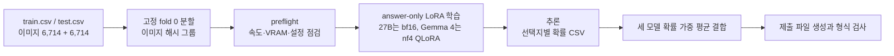

<p align="center">
    
</p>

<div align="center">

# Astralopithecus (Astra + Australopithecus)

**SSAFY 16기 2회차 AI 챌린지: 한국어 이미지 객관식 질의응답**

[](https://python.org)
[](https://pytorch.org)
[](https://huggingface.co/docs/transformers)
[](https://huggingface.co/docs/peft)
[](https://colab.research.google.com)
[](https://www.kaggle.com)
[](docs/submission_report.md)

_이미지 속 글자를 읽어서 네 개의 선택지 가운데 정답 하나를 고르는 한국어 VQA 모델_

</div>

---

## 소개

SSAFY 16기 2회차 AI 챌린지에 팀 Astralopithecus가 제출한 결과물 저장소입니다.

2026년 9월 26일 기준 Public 0.97765를 기록했습니다.

팀 이름 Astralopithecus는 ChatGPT의 Astra와 Australopithecus(오스트랄로피테쿠스)를 합친 이름입니다.

## 팀

| 이름   | GitHub                                                         | 역할                                                               |
| ------ | -------------------------------------------------------------- | ------------------------------------------------------------------ |
| 이준혁 | [@bnbong](https://github.com/bnbong)                           | 팀장, 파이프라인 설계, Colab 27B 학습, 전체 통합 |
| 유수정 | [@ysj120808](https://github.com/ysj120808)                     | 평가, 제출 파일 검사, 확률 결합                     |
| 김창혁 | [@rlckdur123](https://github.com/rlckdur123)                   | 프롬프트 비교, OCR 실험, 오답 유형 분류             |
| 조수빈 | [@217user217](https://github.com/217user217)                   | 데이터 감사, 고정 분할 확정, 오답 라벨 점검         |
| 이유림 | [@steaksteak25-design](https://github.com/steaksteak25-design) | 공통 학습 코드, 9B 실험, OCR 엔진 비교              |

## 결과

아래 값은 [`docs/submission_report.md`](docs/submission_report.md)의 3.5절에서 발췌했습니다.

fold 0은 train을 이미지 기준으로 나눈 고정 검증셋 1,344문항에서 측정한 정확도이고, Public은 Kaggle의 공개 리더보드 점수입니다.

| 후보                | 설정                         | 학습 데이터              | fold 0     | Public      |
| ------------------- | ---------------------------- | ------------------------ | ---------- | ----------- |
| 3B zero-shot        | Qwen2.5-VL-3B, 프롬프트 p2   | 없음                     | 0.9144     | 0.89871     |
| 9B zero-shot        | Qwen3.5-9B, 프롬프트 p2      | 없음                     | 0.9464     | 미제출      |
| 27B zero-shot       | Qwen3.5-27B, 프롬프트 v1     | 없음                     | 0.9539     | 0.95889     |
| LoRA p2             | Qwen3.5-27B, 기본 해상도, p2 | fold 1~4 (5,358)         | 0.9583     | 0.96544     |
| 확대 LoRA p2        | Qwen3.5-27B, 이미지 확대, p2 | fold 1~4 (5,358)         | 0.9688     | 0.96931     |
| 확대 전체 데이터 p2 | Qwen3.5-27B, 이미지 확대, p2 | 전체 (6,690)             | 검증 불가  | 0.96901     |
| Gemma 4 zero-shot   | Gemma-4-31B-it, 시각 토큰 1,120, p2 | 없음              | 0.9695     | 0.96484     |
| Gemma 4 QLoRA       | Gemma-4-31B-it, nf4 QLoRA, 시각 토큰 1,120, p2 | fold 1~4 (5,358) | **0.9747** | 단독 미제출 |
| Gemma 4 전체 QLoRA  | Gemma-4-31B-it, nf4 QLoRA, 시각 토큰 1,120, p2 | 전체 (6,690)     | 검증 불가  | 단독 미제출 |
| InternVL3.5-38B QLoRA | InternVL3.5-38B-HF, nf4 QLoRA, 시각 토큰 1,280, p2 | fold 1~4 (5,358) | 0.9315 | 제출 없음 (기각) |
| 두 모델 결합        | 위 27B 두 모델의 확률 균등 평균 | 위 두 모델의 학습 데이터 | 검증 불가    | 0.97110     |
| 세 모델 가중 결합   | 확대 LoRA 0.3 + 확대 전체 데이터 0.3 + Gemma 4 zero-shot 0.4 | 위 세 모델의 학습 데이터 | 검증 불가 | 0.97616     |
| 세 모델 가중 결합 (QLoRA) | 확대 LoRA 0.3 + 확대 전체 데이터 0.3 + Gemma 4 QLoRA 0.4 | 위 세 모델의 학습 데이터 | 검증 불가 | **0.97765** |
| 네 모델 가중 결합         | 확대 LoRA 0.3 + 확대 전체 데이터 0.3 + Gemma 4 QLoRA 0.2 + Gemma 4 전체 QLoRA 0.2 | 위 네 모델의 학습 데이터 | 검증 불가 | 0.97765 (동점, 미채택) |
| 세 모델 가중 결합 (전체 QLoRA) | 확대 LoRA 0.3 + 확대 전체 데이터 0.3 + Gemma 4 전체 QLoRA 0.4 | 위 세 모델의 학습 데이터 (Gemma는 전체 QLoRA) | 검증 불가 | 0.97676 (미채택) |
| TTA 결합 | 확대 LoRA(A)의 선택지 순열 TTA4 예측 0.3 + 확대 전체 데이터(B) 0.3 + Gemma 4 QLoRA 0.4 | 위 세 모델의 학습 데이터 | 검증 불가 | 0.97676 (미채택) |

최종 제출로는 Gemma 4를 QLoRA로 학습해 섞은 가중 결합(0.97765)을 1순위로, Gemma 4 쪽만
zero-shot 예측으로 되돌린 같은 구조의 결합(0.97616)을 2순위로 골랐습니다. 두 제출물은 가중치가
같고 세 번째 재료만 다르며, 답이 갈린 문항은 6,714문항 가운데 43개입니다. TTA 결합은 A만
TTA4 예측으로 바꾼 경우(제출 보고서의 후보 ㉕)와 A와 B 모두 TTA4 예측으로 바꾼 경우(같은 보고서의
후보 ㉖)를 둘 다 시험했는데, 두 경우 모두 Public 0.97676에 그쳐 최종 선택을 바꾸지 못했습니다.
fold 0에서는 A를 TTA 예측으로 바꾼 결합이 5문항 늘었는데도 test에서는 낮아졌으므로, 이번까지
세 번 모두 TTA로 얻은 이득이 test에서 뒤집힌 셈입니다.

Gemma 4의 가중치 0.4는 zero-shot 결합을 만들 때 fold 0에서 그린 곡선을 보고 미리 고정한 값이며,
QLoRA 결합에도 그 값을 그대로 옮겼습니다. Public 점수를 보고 고른 값이 아닙니다. 비중을 0.55까지
올린 변형은 0.97378로 떨어져 기각했습니다.

마지막으로 Gemma 4를 전체 6,690문항으로 다시 학습해 네 번째 재료로 더한 결합도 만들어 보았습니다.
Gemma 두 모델의 가중치 합은 0.4로 그대로 두고 두 모델이 0.2씩 나누어 가졌는데, Public 점수가
0.97765로 1순위 제출물과 정확히 같은 동점에 그쳤습니다. 같은 전체 학습 모델을 두 모델로 나누지
않고 세 번째 재료 자리에 통째로 넣은 결합도 만들어 보았는데, Public 0.97676으로 1순위 제출물보다
6문항 낮았습니다. 최종 선택을 바꾸는 사전 기준이 "0.97765를 넘어야 한다"였으므로 둘 다 채택하지
않았고, 최종 제출 두 개는 위에 적은 대로 유지했습니다. 같은 계열 변형을 시험하는 실험은 이 결과로
종료했고, 다른 계열 재료인 InternVL3.5-38B의 nf4 QLoRA 학습을 마지막으로 한 번 더 진행했습니다.
그 결과 fold 0 단독 정확도가 0.9315에 그쳐 사전 판정 기준 0.9635에 못 미쳤고 결합에서도 이득이
없어서 기각했으며, test 추론은 수행하지 않았습니다. 이것으로 시도할 수 있는 실험을 모두 마쳤고
GPU 실험을 종료했습니다. 최종 제출은 1순위 0.97765와 2순위 0.97616으로 확정했습니다. 2순위를
Public 점수가 조금 더 높은 0.97676짜리 결합이 아니라 0.97616짜리 결합으로 둔 까닭은, Kaggle의
최종 점수가 두 제출물 가운데 Private 점수가 높은 쪽으로 정해지므로 1순위와 예측이 가장 많이
다른 제출물을 보험으로 두는 편이 낫기 때문입니다.

## 방법

**모델과 학습.** Qwen3.5-27B를 bf16으로 올리고, 언어 경로에만 LoRA를 붙여서 정답 글자 한 개에만 손실을 거는 answer-only 방식으로 학습했습니다. 비전 인코더는 얼리고 학습하지 않았습니다.

**프롬프트.** 이미지 속 글자를 먼저 읽으라고 지시하는 프롬프트 p2(`v2_read_text`)를 fold 0에서 비교해 골랐습니다. 프롬프트는 system turn 없이 user turn 하나로 구성하고 이미지를 텍스트 앞에
둡니다.

**이미지 확대.** 작은 글자를 틀리는 문항이 많았기 때문에 processor의 `min_pixels`를 올려서 작은 이미지를 확대해 넣었습니다. zero-shot 기준으로 fold 0 정확도가 0.9591에서 0.9635로 올랐고, 작은 글자 때문에 틀렸던 8문항 가운데 6문항을 회복했습니다.

**확률 결합.** fold 1~4로 학습한 모델과 전체 데이터로 학습한 모델이 낸 선택지별 확률을 0.5 대 0.5로 평균 냈습니다. 가중치는 검증셋에서 탐색하지 않고 미리 정한 값을 그대로 썼습니다.

**다른 계열 모델 결합.** 같은 Qwen3.5-27B 계열 안에서는 배깅과 dev 세트 추가, epoch 연장 가운데 무엇으로도 두 모델 결합(0.97110)을 넘지 못했기 때문에, 시각 인코더 자체가 다른 Gemma-4-31B-it를 학습 없이 추론만 시켜서 세 번째 확률로 더했습니다. Gemma는 틀린 문항에서도 확률을 1.0에 가깝게 실어 주는 과신 모델이라서 가중치를 절반 아래인 0.4로 낮추어 섞었고, 그 결과 Public 점수가 0.97616까지 올랐습니다.

**Gemma의 nf4 QLoRA 학습.** Gemma는 bf16 가중치가 약 62GB여서 A100 80GB 한 장으로는 학습 하한을 넘지 못했습니다. 그래서 가중치를 nf4로 4bit 양자화해서 올리고 LoRA adapter만 bf16으로 학습했습니다(`configs/colab_gemma4_31b_nf4_lora.yaml`). 시각 인코더와 출력 계층은 양자화에서 제외했습니다. 학습 peak VRAM은 약 32GB였고 fold 0 정확도는 0.9695에서 0.9747로 올랐으며, 오답에 실어 주는 확률의 평균 margin도 0.904에서 0.825로 내려가 과신이 누그러졌습니다. 이 예측을 세 번째 재료로 바꾸어 넣자 Public 점수가 0.97616에서 0.97765로 올랐습니다.

**네 번째 계열 시도.** 같은 방식으로 시각 인코더가 InternViT-6B인 InternVL3.5-38B-HF도 nf4 QLoRA로 학습해 보았지만(`configs/colab_internvl35_38b_nf4_lora.yaml`), fold 0 단독 정확도가 0.9315에 그쳐 사전 판정 기준 0.9635에 못 미쳤고 어느 가중치로 섞어도 기존 결합보다 낮아서 기각했습니다. 계열이 다르기만 해서는 결합 재료가 되지 못하고, 단독 강도가 적어도 확대 LoRA 수준에는 닿아야 결합에서 이득이 난다는 뜻입니다.

**검증.** 이미지 해시를 그룹 키로 삼은 고정 fold 0에서만 모든 비교를 수행했고, 두 예측이 갈린 문항에는 McNemar 검정을 적용했습니다. fold 0의 오답은 전수로 라벨을 점검해서 라벨 자체가 잘못된 문항 35건을 확인했고, 이 값에서 달성 가능한 상한을 약 0.974로 추정했습니다.

## 구조



| 디렉터리       | 내용                                                                                    |
| -------------- | --------------------------------------------------------------------------------------- |
| `vqa/`         | 학습과 추론, 평가, 제출을 담당하는 공통 파이썬 패키지입니다.                            |
| `configs/`     | 모델과 정밀도, 해상도별 학습 설정 YAML 파일입니다.                                      |
| `scripts/`     | 분할 생성과 예측 비교, 확률 결합, 제출 검사를 수행하는 실행 스크립트입니다.             |
| `notebooks/`   | Colab과 실습실 PC에서 여는 진입점 노트북이며 `scripts/build_notebooks.py`가 생성합니다. |
| `results/`     | 실제로 실행을 마친 노트북 사본과 실측 기록입니다.                                       |
| `docs/`        | 제출 설명서와 발표 개요, 팀 운영 문서, 환경 구축 안내입니다.                            |
| `experiments/` | 최종 파이프라인에 들어가지 않은 팀원들의 실험 코드입니다.                               |
| `tests/`       | 프롬프트와 라벨 마스킹, 평가와 제출 경로를 검증하는 pytest 모음입니다.                  |

## 실행

라이선스 이유로 대회 데이터셋은 이 저장소에 들어 있지 않습니다. 

`train/`과 `test/` 폴더, `train.csv`, `test.csv`, `sample_submission.csv`를 프로젝트 루트에 놓고 시작하십시오.

```
pip install -q -r requirements/colab.txt
pip install -q --no-deps -r requirements/colab-nodeps.txt   # fla 가속 커널. 빠지면 약 네 배 느려집니다
python scripts/folds_to_split.py                            # 고정 fold 0 분할 생성
python -m vqa.preflight --config configs/colab_qwen35_27b_bf16_upscale.yaml
python -m vqa.train --config configs/colab_qwen35_27b_bf16_upscale.yaml --run-id ft27_upscale \
    --split artifacts/data/split_fold0.json --set prompt_id=v2_read_text
python -m vqa.predict --config configs/colab_qwen35_27b_bf16_upscale.yaml --run-id ft27_upscale \
    --csv test.csv --adapter <RUN_ROOT>/ft27_upscale/final_adapter --out-name test_ft --set prompt_id=v2_read_text
python -m vqa.train --config configs/colab_gemma4_31b_nf4_lora.yaml \
    --run-id gemma4_31b_ft_nf4_v2_read_text --split artifacts/data/split_fold0.json \
    --set prompt_id=v2_read_text
python -m vqa.predict --config configs/colab_gemma4_31b_nf4_lora.yaml \
    --run-id gemma4_31b_ft_nf4_v2_read_text --csv test.csv \
    --adapter <RUN_ROOT>/gemma4_31b_ft_nf4_v2_read_text/final_adapter \
    --out-name test_ft --set prompt_id=v2_read_text
python scripts/blend_preds.py --a <모델 A의 예측 CSV> --b <모델 B의 예측 CSV> \
    --c <Gemma QLoRA의 예측 CSV> \
    --w-c 0.4 --sample sample_submission.csv --submission submission.csv
```

`--w-c`는 Gemma의 가중치만 정하고 나머지를 A와 B가 반씩 나누므로, `--w-c 0.4`가 곧 A 0.3과 B 0.3과 Gemma 0.4입니다. `--c`를 빼면 A와 B만 `--w-a`로 섞습니다. 2순위 제출물은 위 `--c`에 Gemma QLoRA 예측 대신 `configs/colab_gemma4_31b_bf16.yaml`로 만든 zero-shot 예측을 넣어서 얻습니다.

환경 설치와 run-id 규칙, 제출 파일 sha256을 포함한 상세 절차는 [`docs/submission_report.md`](docs/submission_report.md)의 5절에 있습니다.


## 문서

| 문서                                                             | 내용                                                                                        |
| ---------------------------------------------------------------- | ------------------------------------------------------------------------------------------- |
| [`docs/submission_report.md`](docs/submission_report.md)         | 대회 제출용 설명서입니다. 데이터 처리와 모델 개발 과정, 재현 절차를 한 파일에 정리했습니다. |
| [`docs/presentation_outline.md`](docs/presentation_outline.md)   | 발표 개요와 후보별 비교 표입니다.                                                           |
| [`results/README.md`](results/README.md)                         | Colab A100에서 실측한 속도와 VRAM, 정확도 기록입니다.                                       |
| [`docs/README_team.md`](docs/README_team.md)                     | 팀 내부 운영 문서이며 담당과 게이트 조건, 자주 쓰는 명령이 들어 있습니다.                   |
| [`docs/discussion_fla_kernel.md`](docs/discussion_fla_kernel.md) | fla 가속 커널이 빠졌을 때 학습이 느려지는 현상을 추적한 기록입니다.                         |
| [`docs/history_cleanup.md`](docs/history_cleanup.md)             | 공개 전환 전 이력 정리 절차입니다.                                                          |
| [`docs/plan_initial.md`](docs/plan_initial.md)                   | D1 계획서입니다.                                                                            |

## 기술 스택

| 영역      | 사용 기술                                                                 |
| --------- | ------------------------------------------------------------------------- |
| 모델      | Qwen3.5-27B(최종 채택), Gemma-4-31B-it(nf4 QLoRA로 학습해 결합에 추가), Qwen3.5-9B, Qwen2.5-VL-3B       |
| 학습      | PyTorch 2.11, Transformers 5.16, PEFT 0.20 (LoRA와 nf4 QLoRA), bitsandbytes, fla-core |
| 실행 환경 | Google Colab A100 80GB, Windows RTX 5060 Ti 16GB                          |
| 데이터    | pandas, Pillow, ImageHash, scikit-learn                                   |
| 검증      | pytest, McNemar 검정, 고정 fold 0 분할                                    |
